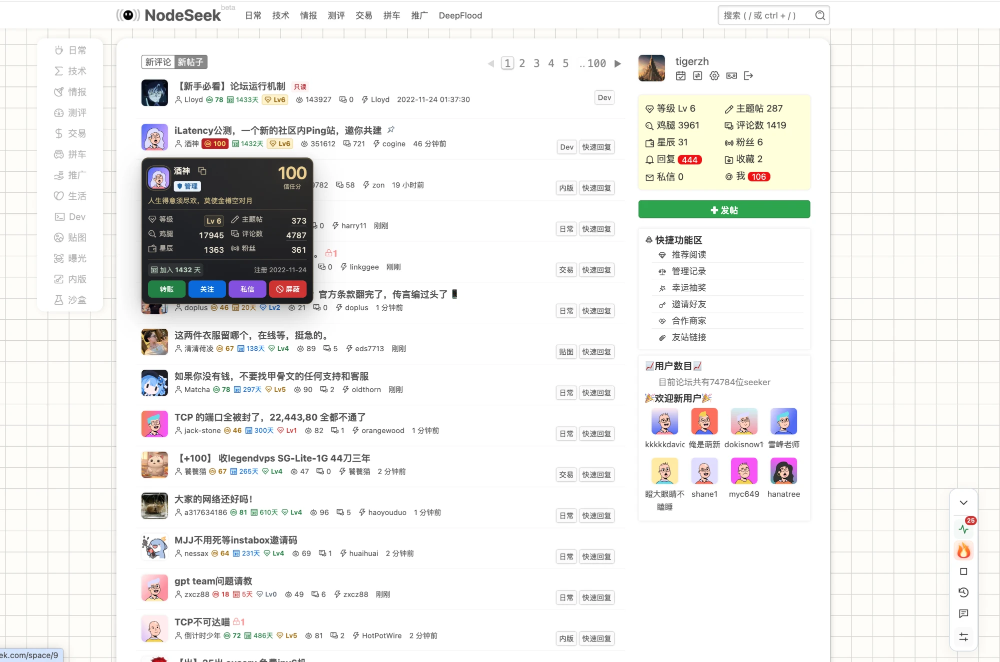
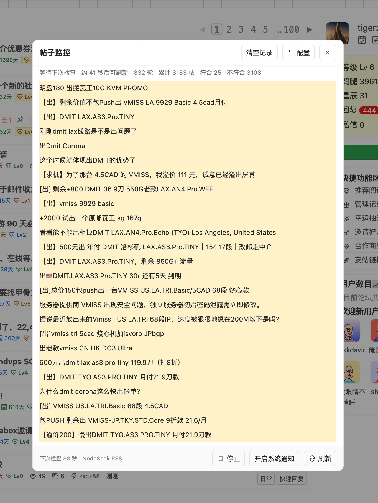
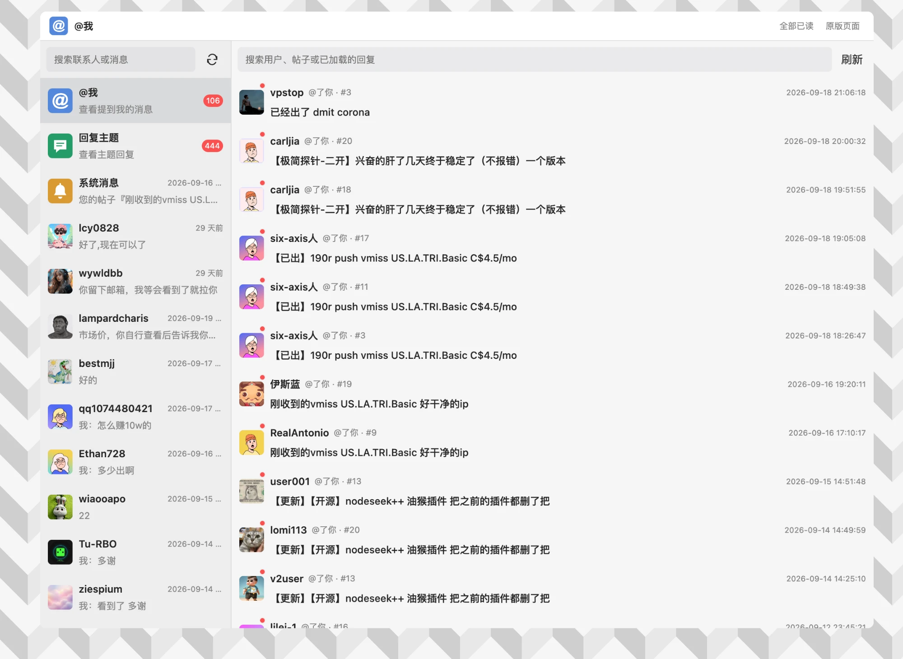
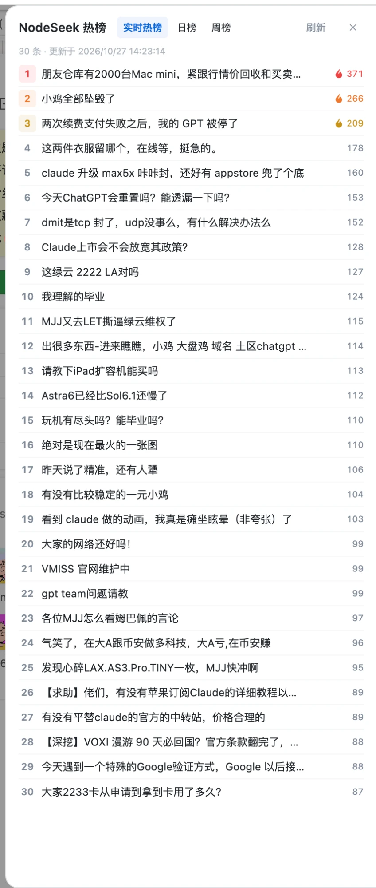
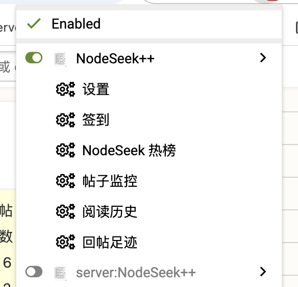
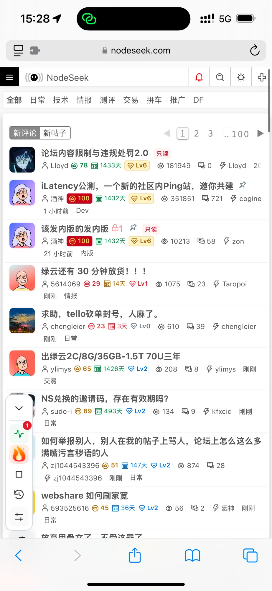
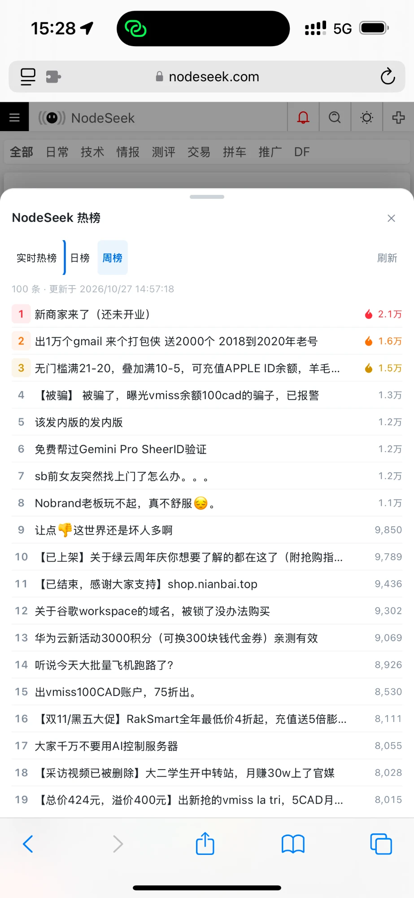
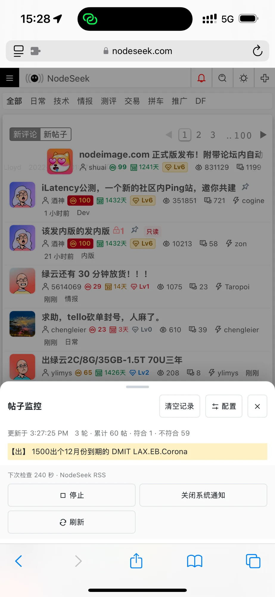

# NodeSeek++

**让 NodeSeek / DeepFlood 更好逛的油猴脚本**

用户资料卡 · 帖子监控 · 实时热榜 · 消息中心 · 阅读增强 · 图片上传 — 桌面与手机都能用

[**⬇ 一键安装**](https://raw.githubusercontent.com/rirh/nodeseek-plus/main/dist/nodeseek-plus-plus.user.js) ·
[Greasy Fork](https://greasyfork.org/zh-CN/scripts/595488) ·
[问题反馈](https://github.com/rirh/nodeseek-plus/issues)

## 功能一览

| | |
| --- | --- |
| **用户资料卡** | 悬停头像即看等级、加入天数、本地信任参考分和发帖统计，可直接转账、关注、私信、屏蔽 |
| **帖子监控** | 基于 NodeSeek RSS，用正则匹配标题，后台标签页持续检查，命中时发系统通知 |
| **实时热榜** | 实时热榜、日榜、周榜一键切换，打开时按需获取 |
| **消息中心** | @我、回复、系统消息、私信合并到一个面板；聊天记录本地存档，支持 Markdown 与图片 |
| **阅读增强** | 自动翻页、阅读历史与已读标记、外链直达、图片预览、代码高亮与复制、只看楼主、长文折叠 |
| **内容过滤** | 按标题关键词、用户名、等级过滤，可隐藏、折叠或仅高亮；本地好友高亮与用户备注 |
| **发帖辅助** | 图片上传（NodeImage 等 6 种图床）、快捷回复模板、Ctrl+Enter 提交、AI 写作助手 |
| **日常** | 自动签到、回帖足迹、手机悬浮回复、屏蔽侧栏广告 |
| **一键分享** | 工具栏分享按钮：保存二维码，或直接分享到 X、Telegram |

所有功能都能在设置里单独开关。

## 截图

<table>
  <tr>
    <td width="50%">
帖子监控：正则匹配新帖
</td>
    <td width="50%">
消息中心：通知与私信合一
</td>
  </tr>
  <tr>
    <td>
实时热榜 / 日榜 / 周榜
</td>
    <td>
脚本管理器菜单快捷入口
</td>
  </tr>
</table>

**手机上同样可用**，面板自动变为底部抽屉：

<table>
  <tr>
    <td width="33%"></td>
    <td width="33%"></td>
    <td width="33%"></td>
  </tr>
</table>

## 安装

1. 安装用户脚本管理器，如 [Tampermonkey](https://www.tampermonkey.net/)（iOS Safari 可用 Userscripts）。
2. 打开 [**安装链接**](https://raw.githubusercontent.com/rirh/nodeseek-plus/main/dist/nodeseek-plus-plus.user.js)，在脚本管理器中点「安装」。
3. 刷新 [NodeSeek](https://www.nodeseek.com/) 或 [DeepFlood](https://www.deepflood.com/)。
4. 点右侧工具栏的设置图标，或在脚本管理器菜单中选择「设置」。

> 如果链接只显示源码，可复制完整 `.user.js` 内容，在脚本管理器中新建脚本粘贴保存。`.meta.js` 只含版本信息，不能用于安装。

## 更新

脚本会自动检查更新：页面打开后检查一次，之后每 6 小时检查；发现新版本会弹窗提醒，同一版本 24 小时内只提醒一次。

也可以在 **设置 → 其他 → 关于** 点「检查更新」，或重新打开安装链接覆盖安装。无需卸载旧版，配置会保留。

## 设置

设置分为「浏览、用户、工具、其他」四类，支持搜索。功能开启后才显示它的选项；导入、导出、清空缓存和恢复默认在「其他 → 数据」中。修改后点「保存并刷新」生效。

## 隐私与数据

- 配置、监控结果、阅读历史、回复模板和私信存档都只保存在本机（脚本管理器存储 / IndexedDB），按站点和账号隔离。
- 信任参考分根据公开的注册时间、发帖数、评论数在本地计算，**不是**站点官方评分，也不代表交易信用。
- 只有在你主动操作时，图片才会发往所选图床，文本才会发往你配置的 AI 服务。
- 脚本不会绕过站点的登录、限流或验证。

## 更多文档

- [使用说明](docs/guide.md)：帖子监控正则写法、图片上传、请求并发、消息中心等细节
- [开发与发布](docs/development.md)：本地开发、测试、`make deploy` 与 Greasy Fork 同步
- [功能矩阵](docs/feature-matrix.md)：上游功能对照与参考来源

## 许可证

[GPL-3.0-only](LICENSE)。第三方依赖适用各自许可证，详见 [第三方说明](THIRD_PARTY_NOTICES.md)。
